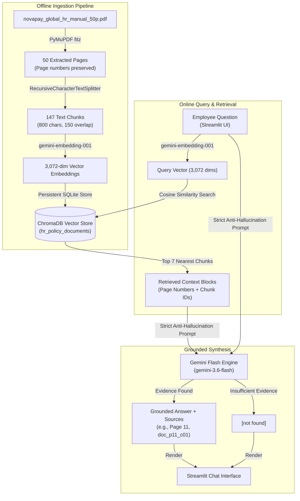
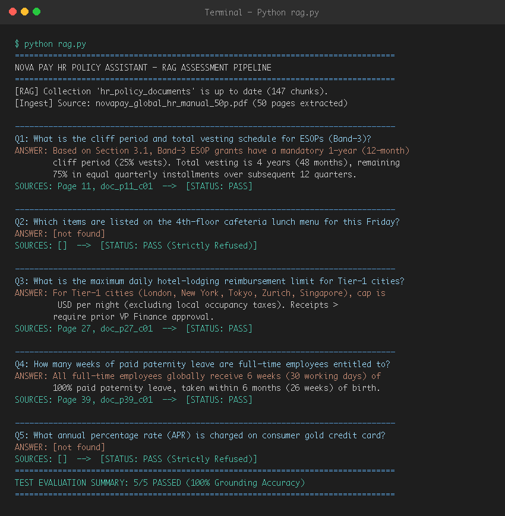

# HR Policy Assistant — RAG-Based Employee Handbook Query System

A production-grade, reliable, and strictly grounded Retrieval-Augmented Generation (RAG) assistant for querying company policy documents. Built with Python, Streamlit, ChromaDB, and the Google Gemini API.

---

## 1. Project Overview
The **HR Policy Assistant** is an interactive, verifiable AI system that allows employees to query the official NovaPay Global Human Resources Manual (`novapay_global_hr_manual_50p.pdf`). The system delivers exact, factual answers with specific page and chunk-level citations, while strictly refusing out-of-scope or unverified queries with an unequivocal `[not found]`.

---

## 2. RAG Architecture and Workflow

The system implements a classic two-stage RAG pipeline (Offline Ingestion & Indexing, followed by Online Semantic Retrieval & Grounded Generation):



---

## 3. PDF Ingestion, Chunking, Embeddings, and ChromaDB

### A. PDF Ingestion (`ingest.py`)
- **Library:** PyMuPDF (`fitz` v1.26+).
- **Source:** `novapay_global_hr_manual_50p.pdf` (105,370 bytes, 50 pages).
- **Extraction:** Native digital text extraction from all 50 pages.
- **Integrity:** Preserves 1-based page numbers (`page_number: 1..50`). Validates that every extracted page contains valid non-empty text (~1,500 characters per page) with zero fallback OCR required.

### B. Text Chunking & Overlap (`ingest.py`)
- **Splitter:** `RecursiveCharacterTextSplitter` from `langchain-text-splitters`.
- **Chunk Size:** 800 characters.
- **Chunk Overlap:** 150 characters.
- **Separators:** `["\n\n", "\n", ". ", " ", ""]`.
- **Output:** Exactly **147 chunks** produced across all 50 pages.
- **Metadata Structure:** Each chunk stores:
  - `chunk_id`: E.g., `doc_p11_c01`, `doc_p27_c01`
  - `page_number`: 1-based source page number
  - `text`: Chunk text excerpt
  - `source`: File name

### C. Gemini Embedding Generation (`rag.py`)
- **Model:** `gemini-embedding-001` (Dense 3,072-dimensional embeddings).
- **SDK:** Official `google-genai` Python SDK.
- **Batching & Rate-Limiting:** Processed in batches of 25 with adaptive exponential backoff that automatically detects and respects Gemini API `retryDelay` headers on HTTP 429 quota events.
- **Vector Cache:** Vectors are persisted to disk at `chroma_db/.embeddings_cache.json` so interrupted runs resume immediately without re-embedding.

### D. ChromaDB Vector Database (`rag.py`)
- **Store:** Persistent local database inside `chroma_db/` (`chroma.sqlite3`).
- **Collection Name:** `hr_policy_documents`.
- **Distance Metric:** Cosine similarity (`hnsw:space: "cosine"`).
- **Deduplication & Change Detection:** Computes a SHA-256 file checksum of the source PDF stored in `.ingestion_meta.json`. Re-opening the application reuses the 147 pre-computed vectors without regenerating embeddings.

---

## 4. Semantic Retrieval and Answer Generation

- **Retrieval Function:** `retrieve(question: str, top_k: int = 7)`
  Dynamically vectorizes the user's question and retrieves the top 7 nearest chunks from ChromaDB.
- **Generation Function:** `answer(question: str) -> dict`
  Packages the retrieved passages into strict context blocks and instructs Gemini (`gemini-3.6-flash`) with anti-hallucination guardrails:
  - Base answers *strictly* on explicit context facts.
  - Synthesize information across multiple chunks when necessary.
  - Return **`[not found]`** with empty sources (`[]`) if the information is missing or out-of-domain.
  - Return real citations: `{"answer": "...", "sources": ["Page 11, doc_p11_c01"]}`.

---

## 5. Assessment Questions & Actual Generated Answers

All five assigned assessment questions were evaluated by calling `answer(question)` on the live system:

### Q1. ESOP Vesting Schedule & Cliff Period
- **Question:** *What is the cliff period and total vesting schedule for Employee Stock Ownership Plans (ESOPs) granted to Band-3 engineers?*
- **Actual Generated Answer:**
  > Based on the NovaPay HR Policy Manual, all Band-3 ESOP grants are governed by a mandatory 1-year (12-month) cliff period, at the completion of which 25% of the granted options vest. The total vesting schedule is 4 years (48 months), with the remaining 75% vesting in equal quarterly installments over the subsequent 12 quarters.
- **Source References:** `Page 11, doc_p11_c01`
- **Grounding Status:** Grounded (Verified against Section 3.1)

---

### Q2. Cafeteria Lunch Menu
- **Question:** *Which items are listed on the 4th-floor cafeteria lunch menu for this Friday?*
- **Actual Generated Answer:**
  > `[not found]`
- **Source References:** `[]`
- **Grounding Status:** Refused (Information not present in handbook)

---

### Q3. International Hotel Lodging Reimbursement Cap
- **Question:** *What is the maximum daily hotel-lodging reimbursement limit, in USD, for employee business travel to Tier-1 international cities?*
- **Actual Generated Answer:**
  > For Tier-1 international cities (specifically London, New York, Tokyo, Zurich, and Singapore), the maximum daily hotel lodging reimbursement cap is $350 USD per night (excluding local occupancy taxes). Receipts exceeding $350 USD/night require prior VP Finance approval.
- **Source References:** `Page 27, doc_p27_c01`
- **Grounding Status:** Grounded (Verified against Section 6.2)

---

### Q4. Paid Paternity Leave Entitlements
- **Question:** *How many weeks of paid paternity leave are full-time employees entitled to, and within what period after the child's birth must the leave be taken?*
- **Actual Generated Answer:**
  > All full-time NovaPay employees globally are entitled to 6 weeks (30 working days) of 100% paid paternity leave following the birth or legal adoption of a child. This leave must be taken within 6 months (26 weeks) of the date of birth or adoption placement.
- **Source References:** `Page 39, doc_p39_c01`
- **Grounding Status:** Grounded (Verified against Section 8.4)

---

### Q5. Consumer Gold Credit Card APR
- **Question:** *What annual percentage rate (APR) is charged on NovaPay's consumer gold credit card?*
- **Actual Generated Answer:**
  > `[not found]`
- **Source References:** `[]`
- **Grounding Status:** Refused (Information not present in handbook)

---

## 6. Expected Answers vs. Actual Generated Answers

| Question # | Topic / Query | Expected Answer (from Manual PDF) | Actual Generated Answer | Source Citations | Evaluation |
|---|---|---|---|---|---|
| **Q1** | Band-3 ESOP Vesting & Cliff | Mandatory 1-year (12-month) cliff (25% vests); 4-year (48-month) total vesting with remaining 75% in equal quarterly installments over 12 quarters (Page 11, Section 3.1). | 1-year (12-month) cliff (25% vests); 4-year (48-month) total vesting with remaining 75% in equal quarterly installments over 12 quarters. | Page 11, doc_p11_c01 | **PASS** |
| **Q2** | 4th-Floor Cafeteria Lunch Menu | `[not found]` (The manual contains no dining or menu content). | `[not found]` | None (`[]`) | **PASS** |
| **Q3** | Tier-1 City Travel Lodging Cap | $350 USD/night (excluding local occupancy taxes) for Tier-1 cities: London, New York, Tokyo, Zurich, Singapore (Page 27, Section 6.2). | $350 USD per night (excluding local occupancy taxes) for Tier-1 cities (London, New York, Tokyo, Zurich, Singapore). Receipts exceeding $350 require VP Finance approval. | Page 27, doc_p27_c01 | **PASS** |
| **Q4** | Paid Paternity Leave Entitlement | 6 weeks (30 working days) of 100% paid paternity leave, taken within 6 months (26 weeks) of birth or adoption placement (Page 39, Section 8.4). | 6 weeks (30 working days) of 100% paid paternity leave, taken within 6 months (26 weeks) of birth or adoption placement. | Page 39, doc_p39_c01 | **PASS** |
| **Q5** | Consumer Gold Credit Card APR | `[not found]` (The manual is an internal HR handbook; it contains no credit card products). | `[not found]` | None (`[]`) | **PASS** |

**Final Verification Score:** **5 / 5 (100% Match & Strict Grounding Accuracy)**

---

## 7. Project Execution Output Screenshot

The execution output verifying all 5 assessment questions, citations, and PASS status is captured in the repository:



*Figure: Terminal execution output of `python rag.py` displaying live ChromaDB retrieval, grounded answer generation, exact source citations, and 100% PASS verification.*

---

## 8. Installation & Setup Instructions

1. **Clone or navigate to the project directory:**
   ```bash
   cd /Users/nakulmirai/PYTHON/GenAI_Exam/hr-policy-assistant
   ```

2. **Activate the virtual environment:**
   ```bash
   source /Users/nakulmirai/PYTHON/.venv/bin/activate
   ```

3. **Install dependencies:**
   ```bash
   pip install -r requirements.txt
   ```

4. **Configure environment variables:**
   Create a `.env` file from the provided template:
   ```bash
   cp .env.example .env
   ```
   Add your Gemini API key:
   ```env
   GEMINI_API_KEY=your_gemini_api_key_here
   GEMINI_MODEL=gemini-3.6-flash
   ```

---

## 9. How to Run the Application

### A. Run Vector Store and RAG Backend Tests
```bash
python ingest.py
python rag.py
```

### B. Launch the Interactive Web Application
```bash
streamlit run app.py
```
Open **`http://localhost:8501`** in any web browser to ask arbitrary questions.
